<p align="center">
  
</p>

<h1 align="center">OpenIndy3D</h1>

<p align="center">
  <b><i>Indiana Jones and the Infernal Machine</i> (1999), running natively on Apple silicon.</b><br>
  Metal rendering · SDL3 input · AVAudioEngine 3D sound · SwiftUI menus
</p>

<p align="center">
  
  
  
  
</p>

---

## What this is

OpenIndy3D is a **native macOS port of the engine** of LucasArts' *Indiana Jones and the Infernal Machine*. It is not
an emulator and not a wrapper: it is built from
[infernal-machine-decomp](docs/DECOMP-README.md), a byte-exact decompilation of the game's Windows executable, with
every piece that talked to Windows (Direct3D, DirectDraw, DirectInput, DirectSound, the registry, Win32 dialogs)
replaced by a new platform layer written for the Mac.

All 17 levels load and play, with the intro movies, music, 3D sound, controllers, saves and the in-game
store — in a window or fullscreen, at 4:3 or widescreen.

> [!IMPORTANT]
> **You need your own copy of the game.** OpenIndy3D contains no game data: no levels, models, textures, sounds,
> music or movies. It plays the copy you own, version 1.2 in English: the Steam or GOG release, the copy DREAMM
> installs, or the original CDs with LucasArts' 1.2 update.

<table>
  <tr>
    <td width="33%">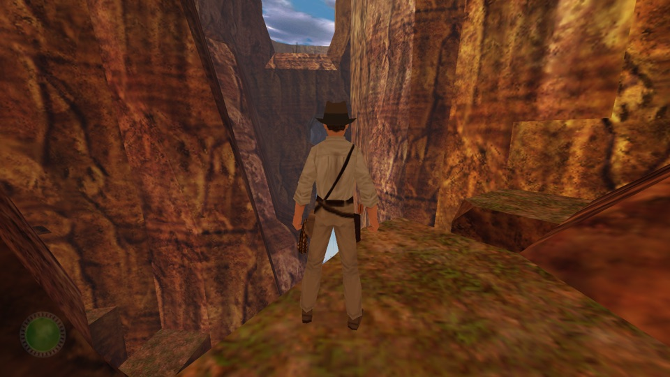<br><sub><b>Canyonlands</b></sub></td>
    <td width="33%">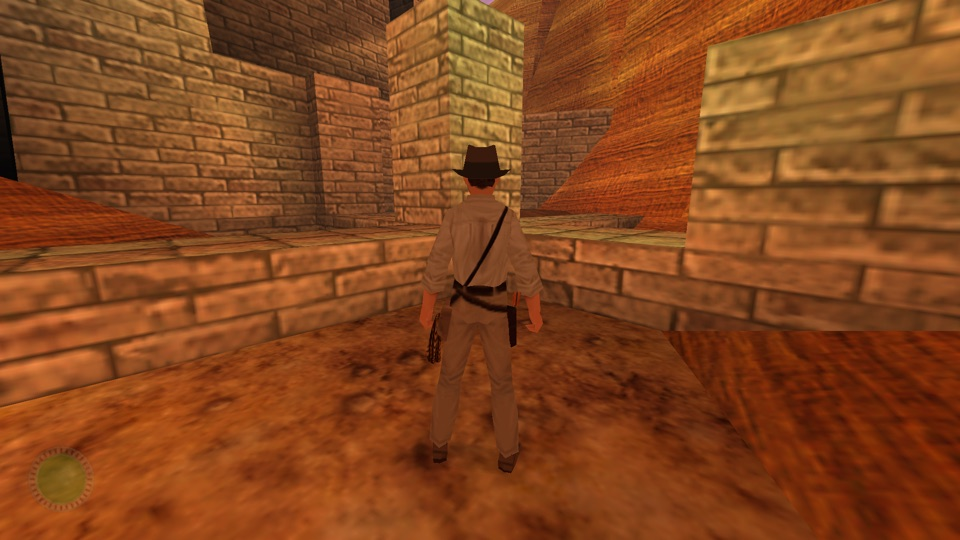<br><sub><b>Babylon</b></sub></td>
    <td width="33%">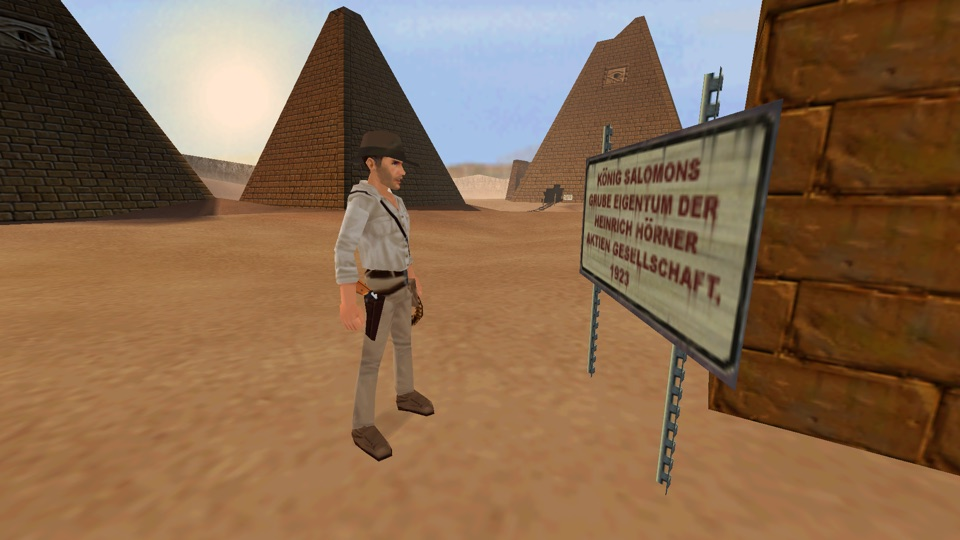<br><sub><b>Meroë Pyramids</b></sub></td>
  </tr>
  <tr>
    <td>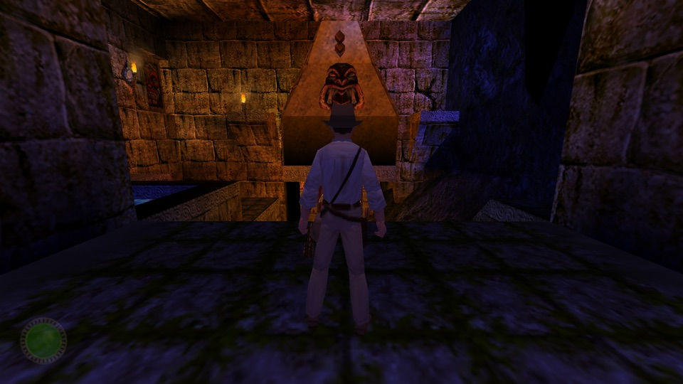<br><sub><b>Palawan Volcano</b></sub></td>
    <td>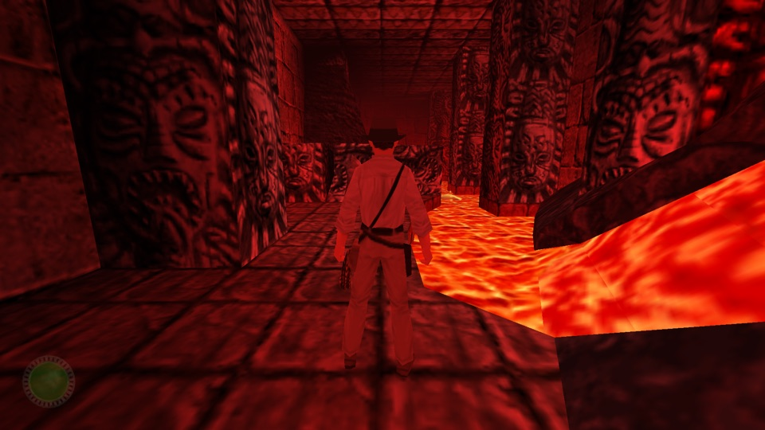<br><sub><b>Palawan Temple</b></sub></td>
    <td>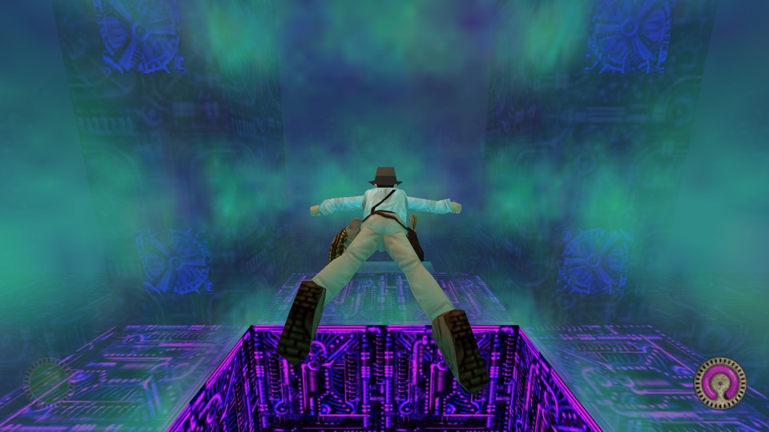<br><sub><b>The Aetherium</b></sub></td>
  </tr>
</table>
<p align="center"><sub>Real frames from the port, 1920×1080, rendered by its Metal renderer
(<code>tools/level_shots.sh</code>).</sub></p>

---

## Contents

- [Playing](#playing)
- [How it works](#how-it-works)
- [Building](#building)
- [Testing](#testing)
- [The road to 1.0](#the-road-to-10)
- [Documentation](#documentation)
- [License and credits](#license-and-credits)

---

## Playing


1. **Install the game** from Steam, GOG or DREAMM, or copy it from the CDs (below).
2. **Open OpenIndy3D.** It finds a Steam, GOG or DREAMM copy by itself — also inside CrossOver and Whisky bottles —
   and otherwise asks for the game's folder, the one that holds `Resource`. Hold <kbd>Option</kbd> while it starts to
   choose another folder.
3. **Play.** The launcher offers *Start New Game*, *Resume Play*, *Help* (the game's manual, when your copy has one)
   and *Options*.

**From the CDs:** copy the installed game folder, then copy `CD1.GOB` from the first CD's `Resource` folder and
`CD2.GOB` from the second's into the folder's `Resource`, beside `JONES3D.GOB`, and apply the 1.2 update.

**Where things go.** Nothing is ever written into the game's folder.

| What | Where |
| --- | --- |
| Settings, saves, screenshots, key sets | `~/Library/Application Support/OpenIndy3D/` |
| Logs and `Crash.log` | `~/Library/Logs/OpenIndy3D/` |

**Controls.** Keyboard and mouse work as in the original, with the retail key sets. Plug in a modern controller and the
port picks its *Dual-Stick Controller* set: left stick moves and turns, right stick sidesteps, A jumps, B crawls,
X activates, Y draws or holsters. <kbd>⌥</kbd>+<kbd>Return</kbd> or <kbd>⌘</kbd><kbd>⌃</kbd><kbd>F</kbd> switches
between fullscreen and a window.

**3D sound.** Turn on *Sound 3D* in the sound options and every sound in the world is placed around you with HRTF,
with distance fades and doppler. With AirPods Pro on macOS 15 or later the sound field even stays put as you turn your
head.

<details>
<summary><b>Command line</b></summary>

```sh
OpenIndy3D.app/Contents/MacOS/OpenIndy3D --help
```

| Option | Effect |
| --- | --- |
| `--data <dir>` | Use the game data in `<dir>` (the folder that holds `Resource`). |
| `--level <n>` | Start a new game at level *n* (1 to 17), skipping the launcher. |
| `--windowed`, `--fullscreen` | Play in a window or full screen this time. |

</details>

---

## How it works

The decompilation gives back the game's original C, function for function. Most of it — the world simulation, the
Cog scripting VM, the AI, the renderer's front end, the sound and movie engines — never cared what operating system
it ran on. Only the bottom layer did. The port keeps the engine and swaps that bottom layer out.

<p align="center">
  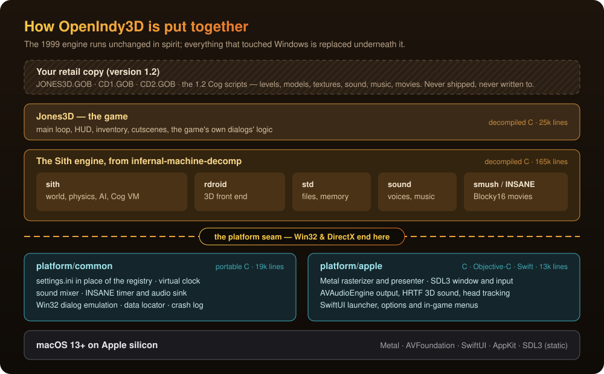
</p>

Each Windows service the 1999 game used has a native replacement:

<p align="center">
  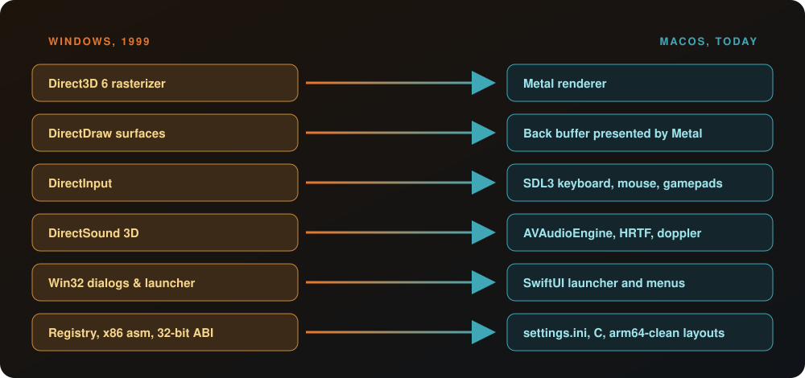
</p>

### One frame, end to end

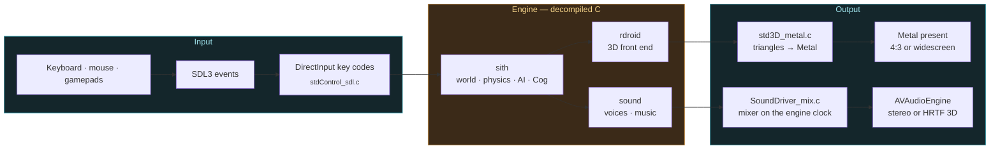

### Starting up

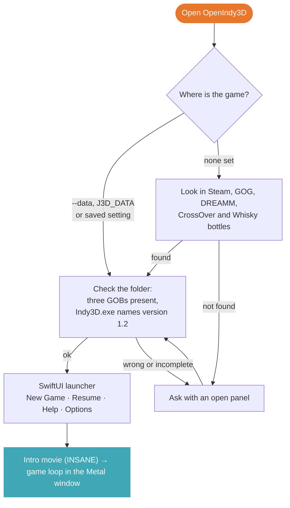

### What makes it trustworthy

- **Byte-exact roots.** The engine is the decomp's code, not a rewrite. Every change the port makes to it is listed in
  [docs/PORTING.md](docs/PORTING.md) and marked `// Port:` in the source.
- **64-bit clean.** `tools/layout_audit.py` compares every on-disk record between the 1999 32-bit layout and arm64 and
  must report `0 retail on-disk type(s) differ`, so saves and levels read exactly as retail wrote them.
- **Deterministic.** A headless run on the virtual clock prints the same log and writes byte-identical saves every
  time; recorded input replays to a byte-identical quicksave.
- **Retail bugs, fixed or not, your choice.** Fixes from OpenJones3D are applied behind `J3D_FIXES`
  ([docs/UPSTREAM-FIXES.md](docs/UPSTREAM-FIXES.md)); `-DJ3D_FIXES=OFF` builds retail's exact behaviour.
- **No warnings.** Every compiler warning is an error, in every file.

### Where the code is

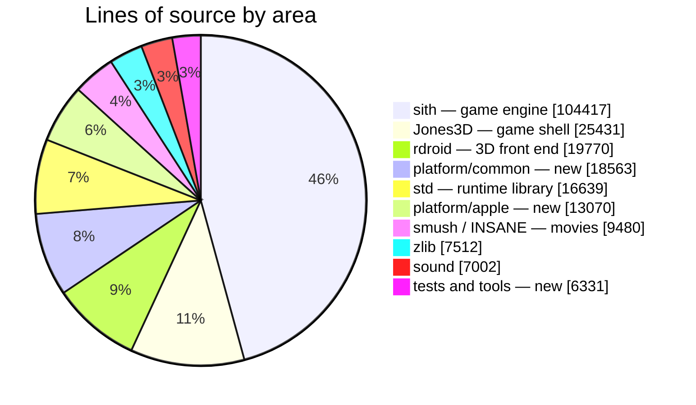

About 38,000 of those lines are new: the platform layer, the tests and the tools. The rest is the decompiled game,
compiled for arm64 with a handful of documented changes.

---

## Building

### Requirements

| | |
| --- | --- |
| **Mac** | Apple silicon, macOS 13 or later |
| **Compiler** | Xcode or the Command Line Tools (Apple clang) |
| **Build tools** | CMake 3.24+ and Ninja: `brew install cmake ninja` |
| **SDL3** | Nothing to install: the first configure downloads the pinned 3.4.20 release, checks its hash and links it statically |
| **Python 3** | Only for the scripts in `tools/` |
| **Game data** | Only to run and test; nothing from it is needed to compile |

### Build the app

```sh
git clone https://github.com/Jenavieve-Rose/OpenIndy3D.git
cd OpenIndy3D
cmake -S . -B build -G Ninja
cmake --build build
open build/OpenIndy3D.app
```

That makes `build/OpenIndy3D.app`, with its icon, About box, `LICENSE` and `NOTICE` inside. To also register the tests
that need game data, point the build at your copy:

```sh
cmake -S . -B build -G Ninja -DJ3D_TEST_DATA=/path/to/game
```

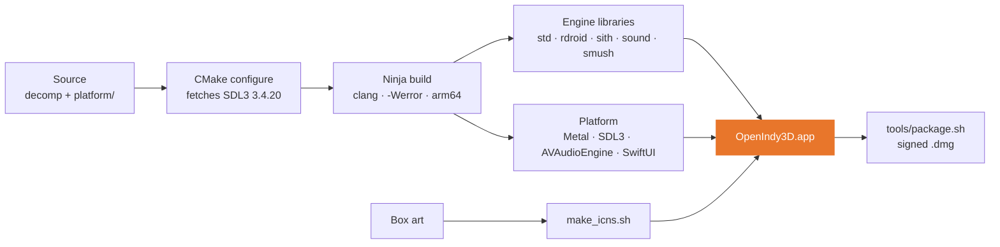

### Build with Xcode

```sh
cmake -S . -B build-xcode -G Xcode
open build-xcode/OpenIndy3D.xcodeproj
```

`CMakeLists.txt` is the source of truth; regenerate the project after adding or removing files.

### Useful options

| Option | Default | Effect |
| --- | --- | --- |
| `J3D_PLATFORM` | `apple` | `null` builds the engine with no window, sound or SDL3 — handy for CI |
| `J3D_FIXES` | `ON` | OpenJones3D's fixes to retail bugs; `OFF` for retail behaviour |
| `J3D_SANITIZE` | `OFF` | AddressSanitizer and UndefinedBehaviorSanitizer for everything |
| `J3D_DEBUG_ASSERTS` | `OFF` | The engine's debug-only asserts and console commands |
| `J3D_ICON_SOURCE` | the box art | Square picture the app icon is made from; empty for none |

### Package a disk image

```sh
tools/package.sh
```

Signs the app with the Hardened Runtime and packs `dist/OpenIndy3D-1.0.1.dmg`. Set `J3D_SIGN_IDENTITY` to your
Developer ID and `J3D_NOTARY_PROFILE` to a `notarytool` profile to notarize it.

Everything else — every option, environment variable, test and tool — is in **[docs/BUILDING.md](docs/BUILDING.md)**.

---

## Testing

The tests are headless programs that boot the real engine against your game data, with no window and no speakers.

```sh
tools/check.sh --data /path/to/game     # the whole check: apple, null and sanitizer trees, every test, the layout audit
ctest --test-dir build --output-on-failure
```

| Test | What it proves |
| --- | --- |
| `levelload` | All 17 levels load through every section loader |
| `cogcheck` | All 1,132 Cog scripts compile |
| `saveload-*` | In every level: save, restore into a fresh world, compare — then save again and compare the files |
| `determinism` | Every level started twice gives identical logs and byte-identical autosaves |
| `moviecheck` | All 2,240 Blocky16 frames of the intro movies match an independent decoder |
| `render`, `present` | The Metal renderer and presenter, pixel by pixel |
| `audio3d`, `sounddriver` | Left is left, right is right, doppler shifts the right way, retail's volume tables |
| `input` | A key moves Indy; a recorded run replays to a byte-identical quicksave |
| `launcher`, `dialogs` | The launcher and every game dialog, driven without clicks |
| `crash` | A crash leaves `Crash.log` with a backtrace and is reported on the next start |

The suite grew with every phase:

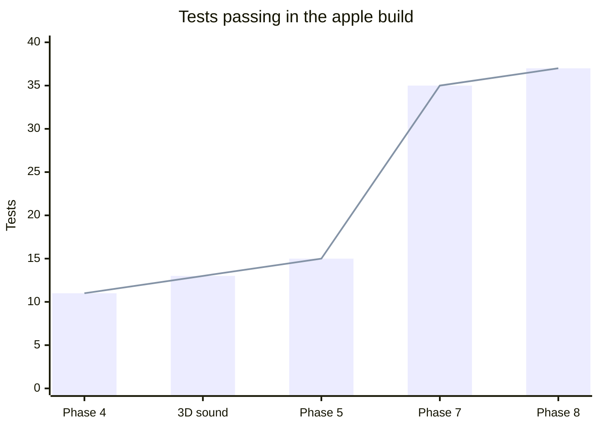

---

## The road to 1.0

The port was planned in nine phases, each ending with a code audit. [docs/PORT-PLAN.md](docs/PORT-PLAN.md) is the
full checklist: **158 of 162 steps done**; what is left is hand testing and notarization.

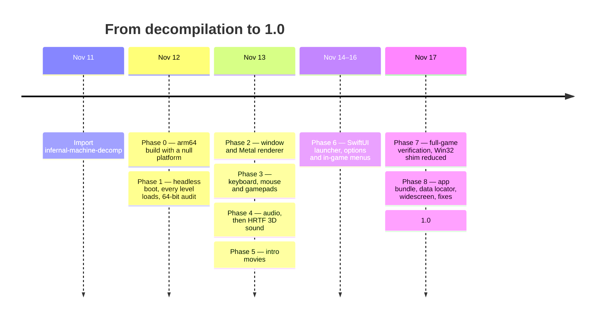

| Phase | Outcome | Steps |
| :---: | --- | :---: |
| 0 | Compiles and links on arm64 with a null platform | 12 / 12 |
| 1 | Headless boot, every level loads, 64-bit audit closed | 30 / 30 |
| 2 | Window, 2D back buffer and Metal renderer | 22 / 22 |
| 3 | Keyboard, mouse and gamepad input | 10 / 10 |
| 4 | Audio, with optional HRTF 3D sound | 11 / 11 |
| 5 | Movies (INSANE) | 12 / 12 |
| 6 | SwiftUI launcher, options and in-game menus | 41 / 41 |
| 7 | Full-game verification, Win32 shim reduced | 8 / 10 |
| 8 | Signed `.app`, data locator, fixes and polish | 12 / 14 |

**Next (phase 9, stretch):** a universal binary, higher-resolution textures from loose files, MSAA and anisotropic
filtering, and an SDL_GPU backend for Linux and Windows.

---

## Documentation

| Document | What's in it |
| --- | --- |
| [BUILDING.md](docs/BUILDING.md) | Every build option, environment variable, test and tool |
| [PORT-PLAN.md](docs/PORT-PLAN.md) | The plan, phase by phase, with what is done and what is open |
| [PORTING.md](docs/PORTING.md) | Every change the port makes to the decompiled source, and why |
| [UPSTREAM-FIXES.md](docs/UPSTREAM-FIXES.md) | Retail bug fixes taken from OpenJones3D |
| [DECISIONS.md](docs/DECISIONS.md) | The design decisions behind the port |
| [DECOMP-README.md](docs/DECOMP-README.md) | The decompilation project the port is built from |

---

## License and credits

OpenIndy3D is free software under the **GNU Affero General Public License v3** ([LICENSE](LICENSE)). Its complete
source, including every change, is at https://github.com/Jenavieve-Rose/OpenIndy3D; anyone who receives the app may
have it under the same license. [NOTICE](NOTICE) lists the projects it is built on and credits — above all
infernal-machine-decomp, OpenJones3D, OpenJKDF2, zlib and SDL.

<sub>"Indiana Jones", "LucasArts" and *Indiana Jones and the Infernal Machine* are trademarks of their respective
owners; the box art and game imagery shown here are © Lucasfilm Ltd. OpenIndy3D is not affiliated with or endorsed by
Lucasfilm, LucasArts or The Walt Disney Company.</sub>
